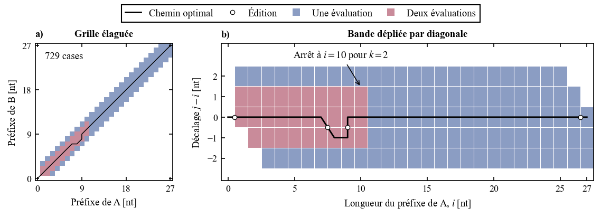

# NvPD · Distance d’édition parallèle

`editdist` calcule la distance de Levenshtein globale entre deux séquences d’ADN. Chaque insertion, suppression ou substitution coûte une unité. NvPD utilise la dernière occurrence de chaque symbole pour calculer en parallèle les colonnes d’une ligne. Le projet compare son coût sur CPU et GPU, puis utilise les distances pour construire des arbres. [Article de Sadiq et coll.](https://doi.org/10.1007/s10586-019-02962-w)

[Rapport complet](report/rapport.pdf) · [Synthèse courte](report/rapport-court.pdf) · [Carnet exécuté](notebooks/profil_nvpd.ipynb) · [Planche des figures](figures/montage.png) · [Résultats par exigence du sujet](results/README.md)

Sur ROMEO, NvPD sur GH200 devance edlib et WFA2-lib sur un cœur Grace pour une des douze paires synthétiques chronométrées à chaud. Cette paire compte un million de bases de référence et 10 % d’éditions injectées. En cinq répétitions, NvPD prend 3,591 ± 0,011 s, edlib 5,903 ± 0,060 s et WFA2-lib 9,835 ± 0,023 s (moyenne ± écart-type). [Mesures sur GH200](results/repeated/gh200/summary.csv)

## Compiler et tester sur CPU

La compilation requiert CMake 3.22 ou ultérieur, un compilateur C et un compilateur C++20 compatible avec OpenMP. Les exemples de données et d’arbres utilisent Python 3.

Sur Debian ou Ubuntu, installer les outils de compilation et Python.

```sh
sudo apt update
sudo apt install git build-essential cmake python3
```

Sur macOS avec Homebrew, installer les outils puis sélectionner GCC avant de configurer CMake. Les noms ci-dessous correspondent à GCC 16. Adapter le suffixe si une autre version est installée.

```sh
brew install git cmake gcc python
export CC=gcc-16 CXX=g++-16
```

Cloner le dépôt, compiler en mode Release, puis lancer les tests.

```sh
git clone https://github.com/wolf75222/nvpd-edit-distance.git
cd nvpd-edit-distance
cmake -S . -B build -DCMAKE_BUILD_TYPE=Release
cmake --build build --parallel 4
ctest --test-dir build --output-on-failure
```

CMake télécharge edlib et WFA2-lib à la première configuration et vérifie leurs empreintes SHA-256. Pour compiler hors ligne, placer les archives dans `deps/edlib.tar.gz` et `deps/wfa2.tar.gz`. [Révisions et empreintes](CMakeLists.txt)

## Aligner deux séquences

Les deux séquences de cet exemple diffèrent par une substitution à la deuxième position.

```sh
printf '>alpha\nACGT\n>beta\nAGGT\n' > build/paire.fa
build/editdist pair --algorithm nvpd-omp --threads 4 --input build/paire.fa
build/editdist pair --algorithm hirschberg --trace --input build/paire.fa
```

Les deux commandes écrivent un objet JSON avec `"distance":1`. La seconde ajoute `"cigar":"1=1X2="`, soit une correspondance, une substitution et deux correspondances. Le champ `seconds` mesure l’alignement après lecture du FASTA. `peak_rss_kib` donne le pic de mémoire du processus en Kio et `device_bytes` la taille des tampons explicites sur le GPU.

Le mode `pair` attend deux entrées FASTA. Le premier mot de chaque en-tête sert d’identifiant et doit être unique dans le fichier. Le programme ignore la casse et compare les symboles IUPAC littéralement. Ainsi, `N` contre `N` coûte zéro et `N` contre `A` coûte un.

Sur un fichier à lignes de largeur régulière, `samtools faidx` crée un index des longueurs. Pour cet exemple optionnel, installer `samtools` avec APT ou Homebrew. L’option `--fai` utilise cet index pour réserver les chaînes avant lecture.

```sh
samtools faidx build/paire.fa
build/editdist pair --algorithm biwfa --trace --input build/paire.fa --fai build/paire.fa.fai
```

## Construire une matrice et deux arbres

Ajouter une troisième séquence au lot, puis construire les arbres UPGMA et Neighbor-Joining à partir de la même matrice.

```sh
cp build/paire.fa build/lot.fa
printf '>gamma\nTTTT\n' >> build/lot.fa
build/editdist matrix --algorithm edlib --input build/lot.fa > build/distances.tsv
python3 scripts/phylogeny/tree.py build/distances.tsv --method upgma --out build/upgma.nwk
python3 scripts/phylogeny/tree.py build/distances.tsv --method nj --out build/nj.nwk
```

Le TSV conserve les identifiants en ligne et en colonne. Ici, `gamma` est à trois éditions de chacune des deux autres séquences. UPGMA regroupe d’abord `alpha` et `beta`.

La cohorte SARS-CoV-2 réunit Wuhan-Hu-1 et neuf génomes complets de chacun des sept lignages retenus, soit 64 accessions versionnées. Avec la commande NCBI `datasets` installée, `python3 scripts/datasets/ncbi_sars.py` reconstitue leur FASTA dans `data/sars/cohort.fa`. Le dépôt contient les 2 016 distances et les deux arbres. Une bande fixe de demi-largeur 323 surestime deux distances de 5 et 19 éditions. La distance de Robinson-Foulds entre l’arbre contraint et l’arbre de référence vaut zéro pour UPGMA comme pour Neighbor-Joining. [Données et manifestes](data/README.md) · [Matrices des cohortes SARS-CoV-2 et φX174](results/phylogeny/README.md) · [Effet de la bande](results/phylogeny/sensitivity/README.md)

Sur 32 cœurs EPYC, subdiviser les rangées de cette matrice ramène Edlib de 1,645 à 0,343 s et WFA2 de 3,616 à 0,775 s. Pour l’hybride NvPD/BiWFA, un filtre sur les effectifs de lettres réduit le temps du noyau de 584 à 448 ms. WFA-GPU, l’aligneur affine sur CUDA d’Aguado-Puig et coll., confie 15 paires de cette cohorte au GPU et 2 001 à WFA2 sur CPU. Avec quatre travailleurs CPU, le temps total atteint 6,844 s pour l’hybride et 6,874 s pour WFA2 seule. [Temps et dispersion sur ROMEO](results/phylogeny/sars-romeo/README.md) · [Ablation du filtre](results/phylogeny/sars-ablation/README.md) · [WFA-GPU](results/wfa-gpu/README.md)

## Générer des paires et mesurer le temps

Générer une référence de 5 000 bases, puis appliquer 5 % d’éditions. Le manifeste TSV conserve le chemin du FASTA, la graine, les longueurs et les effectifs de chaque opération.

```sh
python3 scripts/datasets/synthetic.py --lengths 5000 --rates 0.05 --pairs 1 --out build/synthetique
python3 bench/campaign/run.py --binary build/editdist --manifest build/synthetique/manifest.tsv \
  --target cpu --algorithms seq nvpd-omp --threads 1 4 --trials 3 --output build/mesures.csv
python3 bench/campaign/summarize.py build/mesures.csv > build/resume.csv
```

Avec la graine par défaut (2026), les neuf mesures donnent une distance de 245 pour 250 éditions injectées. Pour répéter le banc, choisir un nouveau nom pour `--output`.

Sans option, le générateur écrit 60 paires dans `data/synthetic/`. Les références de 5 000, 20 000, 100 000 et 1 000 000 nt suivent une loi uniforme sur A, C, G et T. Pour chaque taux (2, 5 et 10 %), il produit cinq paires par longueur. Il tire les positions sans remise et choisit indépendamment chaque type d’édition avec probabilité 1/3. À 1 Mnt, le calcul séquentiel utilise la première paire de chaque taux. La commande `python3 bench/campaign/check_course_corpus.py` régénère les FASTA et vérifie leurs empreintes et les scores archivés. [Manifeste synthétique](data/synthetic/manifest.tsv) · [Couverture des campagnes ROMEO](results/romeo/README.md)

Le résumé de cette campagne donne le temps médian et l’accélération par rapport au séquentiel sur la même paire. Pour une méthode dense, le débit en GCUPS vaut $mn/(10^9 T)$, avec $T$ en secondes. Les mesures répétées du rapport utilisent des processus préchauffés et publient les moyennes, les écarts-types et les intervalles de confiance. [Soumission Slurm sur ROMEO](bench/README.md) · [Mesures répétées](results/repeated/README.md)

## Aligner des chromosomes humains

Pour reproduire la comparaison entre les assemblages CHM13 v1.0 et v1.1, télécharger les deux versions et préparer les 18 chromosomes du panel. Les entrées du chromosome 1 dépassent chacune 248 millions de bases.

```sh
python3 scripts/datasets/chm13_panel.py --cache build/t2t-cache --out data/human/chm13-panel
build/editdist pair --algorithm wfa2 --input data/human/chm13-panel/chr1.fa
build/editdist pair --algorithm nvpd-split --threads 8 --trace --input data/human/chm13-panel/chr1.fa
```

Le score attendu est 176. Le jeu GRCh38–CHM13 compare deux références humaines distinctes sur le chromosome 21. Le banc fournit notamment les temps et la mémoire nécessaires pour restituer un chemin de 32 millions de bases. [Chromosomes complets](results/human/chromosome-panel/README.md) · [Fronts bidirectionnels](results/human/algorithms/README.md) · [Kokkos sur EPYC et GH200](results/kokkos/human/README.md) · [MPI à 192 et 384 cœurs](results/mpi/human/README.md)

Sur un cœur EPYC, `nvpd-adaptive` ramène le temps de NvPD de 25,12 s à 97,65 ms sur la fenêtre de 250 000 bases. À un million de bases et 2 336 éditions, WFA2 reste plus rapide avec 7,07 ms contre 1,608 s. Sur le chromosome 1, `nvpd-split` vérifie six coupes et confie les deux fragments restants à BiWFA après élagage. Le CIGAR complet prend 11,81 ms en moyenne à huit cœurs, contre 183,11 ms pour WFA2 sur un cœur. Sur les chromosomes 18 et 20, deux fragments par paire utilisent le noyau NvPD. [Profils CPU](results/adaptive/README.md) · [CIGAR chromosomiques](results/trace/chromosomes/README.md) · [Mesures GH200](results/roofline/gpu/README.md)

## Distribuer une matrice humaine

Sur une allocation MPI, `--schedule` répartit les paires entre rangs. L’exemple suppose deux nœuds EPYC de 192 cœurs, le FASTA du panel humain et une compilation avec MPI et Kokkos/OpenMP.

```sh
mpirun -n 48 --map-by ppr:24:node:PE=8 --bind-to core build/editdist-mpi matrix \
  --input data/mpi-schedules/length.fa --threads 8 --schedule hilbert-weighted \
  --workers kokkos --grain 4 > distances.tsv
```

Les autres politiques sont `static`, `cyclic`, `hilbert` et `steal`. L’option `--workers openmp` sélectionne une équipe OpenMP directe. À 384 cœurs, la pondération par cellules divise par 5,48 le temps du parcours de Hilbert sur les entrées triées par longueur. Son efficacité forte de 192 à 384 cœurs vaut 98,3 % (IC à 95 % de 95,7 à 100,9 %). Sur une autre allocation, le rapport des temps OpenMP/Kokkos atteint 0,998 pour cette politique (IC à 95 % de 0,969 à 1,027). [Construction du panel et mesures](results/mpi/schedules/README.md) · [Comparaison des travailleurs](results/mpi/workers/README.md)

## Choisir une implémentation

| Méthode ou option CMake | Utilisation |
| --- | --- |
| `seq`, `diagonal`, `nvpd-omp` | Programmation dynamique séquentielle, parcours par anti-diagonales OpenMP ou calcul NvPD par ligne. `--threads` fixe la taille de l’équipe OpenMP. |
| `edlib`, `wfa2`, `biwfa` | Edlib de Šošić et Šikić utilise le parallélisme sur bits. WFA2 de Marco-Sola et coll. suit des fronts de coût croissant. BiWFA des mêmes auteurs les propage depuis les deux extrémités. Les deux parcours WFA acceptent `--trace`. |
| `nvpd-adaptive` | Score seul. Une borne sur le nombre d’éditions limite les colonnes NvPD. La bande s’élargit jusqu’à couvrir un chemin optimal. |
| `nvpd-split` | Score ou CIGAR global. Des fragments indépendants partagent les cœurs. Des mots uniques vérifient les coupes et les intervalles restants sont réalignés. |
| `banded`, `banded-trim` | Le calcul élargit la bande jusqu’à couvrir la distance. `banded-trim` retire d’abord le préfixe et le suffixe identiques. |
| `hirschberg` | Reconstruit le chemin en mémoire linéaire. `--trace` fonctionne aussi avec edlib et, jusqu’à 20 000 bases par séquence, avec `seq` et NvPD. |
| `-DCHPS_CUDA=ON` | Active `nvpd-cuda` et `nvpd-cuda-local` avec un compilateur CUDA C++20. Ce dernier calcule le halo nécessaire à chaque bloc de colonnes. Sur GH200, ajouter `-DCMAKE_CUDA_ARCHITECTURES=90`. |
| `-DCHPS_KOKKOS=ON` | Active `nvpd-kokkos` avec Kokkos ≥ 4. Le mode score garde une équipe sur CPU et fusionne deux lignes sur GPU. |
| `-DCHPS_MPI=ON` | Construit `editdist-mpi`. Le mode `pair` distribue une paire et le mode `pairs` distribue les paires successives du FASTA. |
| `-DCHPS_QUICKED=ON` | Construit `editdist-quicked`, avec contrôle du score par edlib. |

`build/editdist --help` affiche les modes et les options. A*PA2 de Groot Koerkamp associe un parcours en blocs SIMD à une heuristique de coût restant. QuickEd de Doblas et coll. estime une borne pour reconstruire l’alignement en bande par parallélisme sur bits. Si tous les chemins optimaux sortent de la bande, le meilleur alignement accessible peut coûter davantage. Une erreur distincte de lecture au bord d’un mot de bits affecte deux témoins sur EPYC. L’adaptateur protège ce bord, rejoue le chemin et élargit la recherche si son coût diffère de celui d’edlib. [Comparaison sur le chromosome 21](results/alternatives/human/README.md) · [Comparaison avec QuickEd d’origine](results/alternatives/README.md)

## Se repérer dans le dépôt

Les noyaux et la ligne de commande se trouvent dans `src/`, les interfaces dans `include/chps/` et les tests dans `tests/`. Les outils de `scripts/` préparent les données et les arbres. Les bancs de `bench/` produisent les tables de `results/`. Le carnet dans `notebooks/` utilise les fonctions de tracé de `python/`. Les figures de `figures/` alimentent le rapport et sa synthèse courte, qui se compile depuis `report/rapport-court.tex` ou `report/tldr.tex`. [Sources](src/) · [Tests](tests/) · [Résultats](results/)

La [comparaison des temps](figures/comparison/synthese.png) couvre douze paires synthétiques. Chaque case donne le rapport NvPD/bibliothèque, son écart-type et l’intervalle de confiance à 95 % à paire fixée. La [répartition entre rangs](figures/distributed/concentration_rangs.png) montre qui exécute les cellules lorsque les paires ont des tailles inégales.

Sur le chromosome 20, le premier budget de NvPD s’épuise à la dixième ligne. La couleur repère les cellules que le second passage doit recalculer. Les deux autres cartes situent les paires coûteuses dans la matrice MPI et les révisions dans les chromosomes de CHM13. [Partitions de Hilbert](figures/distributed/carte_paires.pdf) · [Révisions de CHM13](figures/biology/paysage_chromosomique.pdf)

[](figures/cpu/geometrie_bande.pdf)

Depuis la racine, les commandes suivantes régénèrent le carnet, les figures et les deux PDF avec Python 3.11 et Tectonic. La conversion du schéma TikZ en SVG utilise `pdftocairo` (Poppler).

```sh
python3.11 -m venv .venv-figures
. .venv-figures/bin/activate
python -m pip install -r notebooks/requirements.txt
python report/figures/phylograms.py
python report/figures/render_decision.py
python -m jupyter nbconvert --to notebook --execute --inplace notebooks/profil_nvpd.ipynb
(cd report && tectonic rapport.tex && tectonic rapport-court.tex)
```
